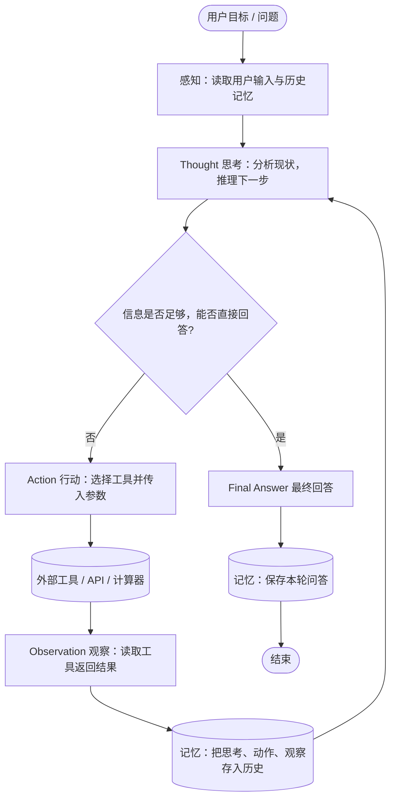

# 学习笔记 · 周一 11/16 — Agent 四组件 + ReAct 循环流程图

> 第 3 周第 1 天。目标：建立 Agent 的整体结构认知（感知 / 规划 / 执行 / 记忆），并画出 ReAct 循环流程图。明天开始手写 `min_agent.py` 的 Thought/Action 解析骨架。

---

## 一、Agent 四组件

一个完整 Agent 可以拆成四个组件。它们和第 2 周写过的代码一一对应，也指明了第 3 周要补的部分。

| 组件 | 英文 | 职责 | 本项目现状 | 第 3 周补什么 |
|------|------|------|-----------|--------------|
| **感知** | Perception | 接收用户输入、读取环境与工具返回结果 | `messages` 里的 user 消息；天气助手读 HTTP 请求体 | 读取工具返回的 Observation 并入上下文 |
| **规划** | Planning | 把目标拆成步骤，决定下一步做什么，判断是否完成 | 暂无（脚本流程写死） | ReAct 循环：Thought 推理 → 决策 → 再循环 |
| **执行** | Action | 调用工具、运行代码、访问外部 API | 天气助手内部调和风 API（代码写死） | Function Calling：由模型自主选择工具并传参 |
| **记忆** | Memory | 保存对话历史、中间结果，供后续轮次使用 | `Conversation` 类（短期对话历史） | 记忆字典；后续第 5 周接向量库做长期记忆 |

### 四组件关系
```
感知（输入/观察） → 规划（思考决策） → 执行（调工具） → 记忆（存历史）
        ↑                                                  │
        └──────────── 结果回到上下文，进入下一轮 ──────────┘
```

记忆是横切层：每一轮的输入、思考、动作、观察都要写进记忆，下一轮规划时才能看到完整上下文。

---

## 二、ReAct 范式：Reason + Act 交替

**ReAct** = Reasoning（推理）+ Acting（行动）。模型在循环里交替做两件事：

1. **Thought（思考）**：分析当前已知信息，推理下一步该做什么。
2. **Action（行动）**：调用某个工具并给出参数。
3. **Observation（观察）**：读取工具返回的结果，作为新信息加入上下文。
4. 回到 Thought，直到模型判断信息足够，输出 **Final Answer**。

### 2.1 ReAct 循环流程图（Mermaid）



### 2.2 一轮 ReAct 对话示例（直觉理解）

问题：**"128 乘以 46 是多少？再加上 750。"**

```
Thought: 需要先算 128 × 46，我自己心算容易错，应该调用计算器工具。
Action:  calculator(expression="128 * 46")
Observation: 5888
Thought: 乘积是 5888，下一步加 750，继续用计算器。
Action:  calculator(expression="5888 + 750")
Observation: 6638
Thought: 结果 6638，信息已足够，可以回答。
Final Answer: 128 × 46 + 750 = 6638。
```

要点：模型不是一次性把答案"想"出来，而是**边做边看结果**，每一步的 Observation 都喂回下一轮 Thought。

### 2.3 ReAct 与其他范式的区别（先混脸熟，第 4 章手写）
| 范式 | 思路 | 适用 |
|------|------|------|
| **ReAct** | 思考—行动—观察，边做边调整 | 通用、工具调用，最基础 |
| **Plan-and-Solve** | 先列完整计划，再逐步执行 | 步骤清晰、需要全局规划 |
| **Reflection** | 执行后自我批判、反思重试 | 对质量要求高、需要纠错 |

---

## 三、对照第 3 周排期（ReAct 落地路线）

| 日期 | 计划任务 | 对应组件 |
|------|---------|---------|
| 周二 | ReAct 范式 Thought→Action→Observation；`min_agent.py` 骨架（Thought/Action 解析） | 规划 + 执行骨架 |
| 周三 | Function Calling / Tool Use；定义 2 个工具（计算器、时间查询） | 执行 |
| 周四 | 工具注册与路由；把工具接入 `min_agent.py` | 执行 |
| 周五 | 记忆（短期对话 + 长期向量存）；给 Agent 加简单 memory 字典 | 记忆 |
| 周六 | 完整跑一遍 ReAct 循环调试；`min_agent.py` 端到端跑通 | 四组件合流 |
| 周日 | 复盘踩坑、写注释；整理代码提交 + ReAct 原理笔记 | 复盘 |

---

## 四、易混点 / 面试话术

- **四组件不是四个独立文件**：感知和执行偏 IO，规划是循环核心，记忆是横切层；手写骨架时它们会落在同一个 `min_agent.py` 的不同函数里。
- **Thought 不是给用户看的**：Thought 是模型的内部推理，Observation 是工具结果，只有 Final Answer 才输出给用户。
- **ReAct 的价值**：把"模型一次生成答案"变成"模型在真实反馈上迭代"，用工具结果压制幻觉、用分步执行降低推理错误。
- **循环要有终止条件**：达到 Final Answer、或超过最大轮数上限（防止死循环），否则 Agent 会一直调工具。

---

## 五、今天的产物
- 笔记：`notes/2026-11-16_agent-four-components-react.md`（含 ReAct Mermaid 流程图）。
- 明天：`min_agent.py` 骨架——解析模型输出里的 Thought / Action。
